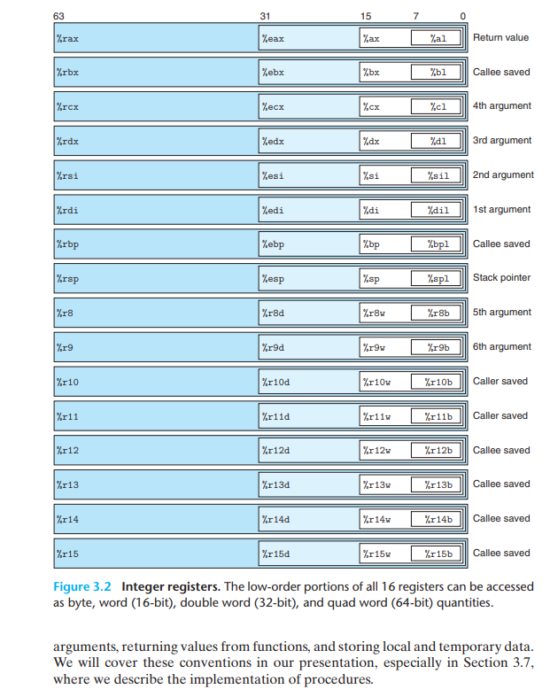
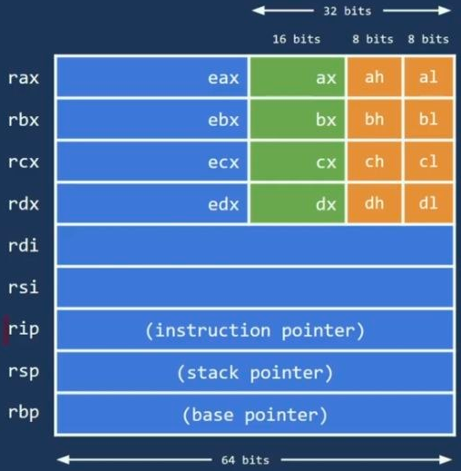

# Low-Level & Reversing Handbook

Bienvenido a mis notas de x86-64 y reversing.

## Formato de Tipos Primitivos en Memoria (x86-64)

| Tipo en C | Bytes | Bits | Rango Unsigned | Rango Signed (Complemento a 2) |
|---|:---:|:---:|---|---|
| `char` | 1 | 8 | 0 a 255 | -128 a +127 |
| `short` | 2 | 16 | 0 a 65.535 | -32.768 a +32.767 |
| `int` | 4 | 32 | 0 a 4.294.967.295 | -2.147.483.648 a +2.147.483.647 |
| `long` / `int64_t` | 8 | 64 | 0 a $\approx 1.84 \times 10^{19}$ | $\approx -9.22 \times 10^{18}$ a $+9.22 \times 10^{18}$ |
| **Puntero (`T *`)** | **8** | **64** | Toda la memoria virtual direccionable | — |

## Chuleta Práctica de Aritmética de Bajo Nivel (CS:APP Cap 2)

### 1. La Escalera de Hitos Hexadecimales (Sin Calculadora)
Para convertir rápidamente entre decimal y hexadecimal sin hacer divisiones complejas:

| Hex | Decimal | Significado / Uso Clave |
|:---:|:---:|---|
| `0x10` | 16 | 1 grupo completo de 16 (`0x10 - 1 = 0x0F`) |
| `0x20` | 32 | Salto habitual de alineamiento / Shadow Space Windows |
| `0x30` | 48 | Hito intermedio |
| `0x40` | 64 | Tamaño común de línea de caché (Cache Line) |
| `0x50` | 80 | Hito intermedio |
| `0x64` | 100 | El valor estándar de vida en videojuegos |
| `0x80` | 128 | Mitad de un byte (`0x80 - 1 = 0x7F`) |
| `0xFF` | 255 | 1 byte completo a tope (`1111 1111`) / `-1` en signed |

> **Regla de acarreo:** En hexadecimal, cada dígito son paquetes de 16.  
> Al restar 1 a un número que termina en cero (ej. `0x80 - 1`), el primer dígito baja 1 unidad (`8 -> 7`) y el segundo recibe un paquete de 16 (`16 - 1 = 15 = F`), resultando en `0x7F`.

---

### 2. Operaciones a Nivel de Bit (Bitwise Operations)

| Operación | Símbolo en C | En ASM | Regla Mnemotécnica |
|---|:---:|:---:|---|
| **NOT** | `~` | `NOT` | **Invertir:** `0 -> 1` y `1 -> 0` |
| **AND** | `&` | `AND` | **Filtro estricto:** Da `1` solo si AMBOS bits son `1` |
| **OR** | `\|` | `OR` | **Encendido:** Da `1` si AL MENOS UNO es `1` |
| **XOR** | `^` | `XOR` | **Distintos:** Da `1` solo si son diferentes (`a ^ a = 0`) |

#### El Secreto de las Máscaras (Bit Masking):
* **`F` (`1111`):** Todos los bits encendidos. Funciona como un cristal transparente. `DATO & 0xFF` deja intacto el byte.
* **`0` (`0000`):** Apaga y borra todos los bits (`DATO & 0x00 = 0`).
* **Borrar campos:** Usar `&` con ceros donde se desea borrar.
* **Forzar campos a 1:** Usar `|` con `F` donde se desea encender.

---

### 3. Desplazamientos de Bits (Bit Shifts)
Forma ultraeficiente de la CPU para multiplicar/dividir sin calentar el procesador:

* **Shift Izquierda (`x << k` / `SHL`):** Multiplica por $2^k$.
  * `x << 1` $\rightarrow$ Multiplica por 2
  * `x << 2` $\rightarrow$ Multiplica por 4
  * `x << 3` $\rightarrow$ Multiplica por 8
* **Shift Derecha (`x >> k` / `SHR` / `SAR`):** Divide entre $2^k$.
  * `x >> 1` $\rightarrow$ Divide entre 2
  * `x >> 2` $\rightarrow$ Divide entre 4

---

### 4. Números Negativos: Complemento a 2 (Two's Complement)
La CPU no tiene cables para el signo menos (`-`). En su lugar, el **bit más a la izquierda (MSB)** tiene un **peso negativo**:

* En 4 bits: los pesos son $\mathbf{-8}, 4, 2, 1$.
  * `0101` $\rightarrow$ $+4 + 1 = \mathbf{+5}$
  * `1111` $\rightarrow$ $-8 + 4 + 2 + 1 = \mathbf{-1}$
  * `1011` $\rightarrow$ $-8 + 2 + 1 = \mathbf{-5}$
  * `1100` $\rightarrow$ $-8 + 4 = \mathbf{-4}$

